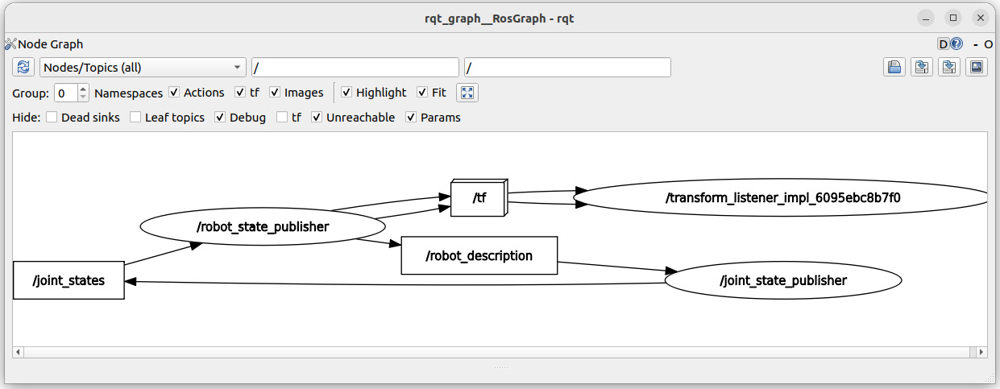
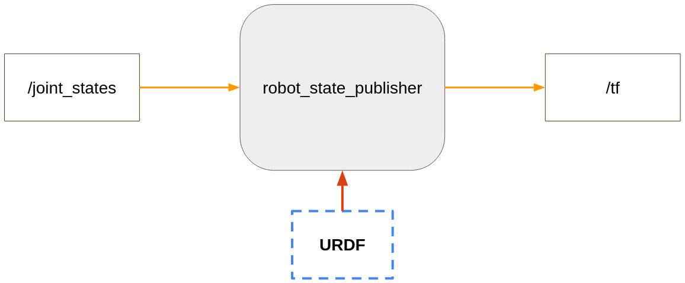
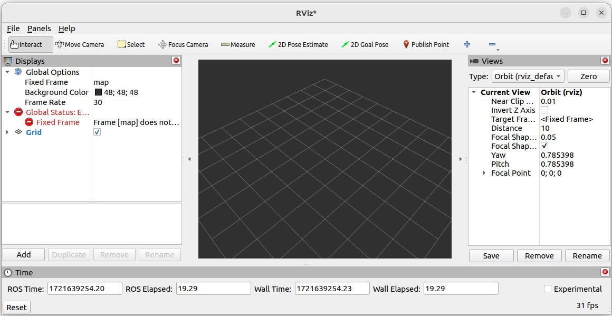
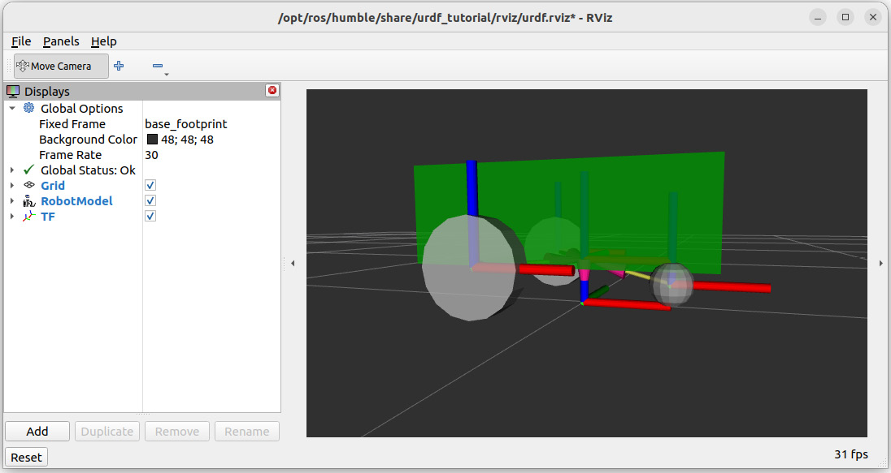

# 12

# Publishing TFs and Packaging the URDF

So far, in *Part 3* of this book, you’ve had an introduction to TFs and have learned how to write a URDF, which will be used to generate the TFs for your robotics application. There are now two things we need to do to go further.

First, to be quicker, we have used the **urdf\_tutorial** package to publish the TFs. This is great to get started and visualize the robot model, but we won’t use this package in a real application. The question is this then: Using the URDF we have created, how do we generate the TFs for our application? What nodes do we need to start? We will first understand, through experimentation, what nodes and parameters we need to start to correctly generate the TFs for our application. From this, we will be able to create our own launch file.

Second, the URDF is now a series of three Xacro files placed inside the home directory. To start a proper ROS 2 application, we will create a package to organize and install the URDF, the launch file, and so on.

By the end of this chapter, you will be able to correctly package your URDF and publish the TFs for a ROS 2 application. This process is the same for any robot, and this package you create here will be the base for any further development, including the Gazebo simulation that we will cover later in this book.

As a starting point for this chapter, we will use the code inside the **ch11** folder from the book’s GitHub repository (<https://github.com/PacktPublishing/ROS-2-from-Scratch>). You can find the final code in the **ch12** folder.

In this chapter, we will cover the following topics:

- Understanding how to publish TFs with our URDF
- Starting all nodes from the terminal
- Creating a package to install the URDF
- Writing a launch file to publish TFs and visualize the robot

# Understanding how to publish TFs with our URDF

We will start this chapter by understanding what nodes and parameters we need to start in order to publish the TFs for our application. Then, with this knowledge, we will be able to start the required nodes, package the application, and write a launch file.

As we often did in this book, we will start with a discovery phase, through experimentation. I recommend that you run all the commands as you read the section.

## The robot\_state\_publisher node

Basically, in this chapter, we want to replicate what was done with the **urdf\_tutorial** package so we can publish the TFs by ourselves. Let’s then start the **display.launch.py** launch file again, using the URDF from the previous chapter, and do some introspection:

```
$ ros2 launch urdf_tutorial display.launch.py model:=/home/<user>/my_robot.urdf.xacro
```

In a second terminal, start **rqt\_graph** to visualize the nodes that are currently running. Refresh the view if the screen is empty. You will see something like this:



Figure 12.1 – Nodes running with urdf\_tutorial

We see the **/tf** topic, which is the most important thing here. This is what’s needed for any ROS application to work properly.

Now, what is publishing on the **/tf** topic? As you can see, there is a node called **/robot\_state\_publisher** (in the text, we will write **robot\_state\_publisher**, without the leading slash). Where does this node come from? **robot\_state\_publisher** is a core node already available for you to use. It is a part of the collection of packages that you installed with ROS 2. This node will publish the TFs for your robot. You will start it in any ROS 2 application where you need TFs. Most of the time, you won’t have to publish any TF by yourself, as this will be handled by the **robot\_state\_publisher** node.

Now that we know we have to start this node, what inputs are required?

## Inputs for the robot\_state\_publisher

There are two things you need to provide for the **robot\_state\_publisher** node to work correctly: URDF and joint states. Let’s start with the first one.

### URDF as a parameter

At this point, you might wonder: Where did the URDF go? We just saw some nodes and topics on **rqt\_graph**, but we didn’t see the use of the URDF we created.

Keep **display.launch.py** from **urdf\_tutorial** running, and in another terminal, list all parameters for the **robot\_state\_publisher** node:

```
$ ros2 param list /robot_state_publisher
```

You will see quite a few, but the one that we care about here is named **robot\_description**. Then, you can read the value from this parameter:

```
$ ros2 param get /robot_state_publisher robot_description
```

With this, you will see the entire URDF in the terminal (or more precisely, the generated URDF from the Xacro file you have provided).

So, when you start the **robot\_state\_publisher** node, you will need to give the URDF inside a parameter named **robot\_description**.

Note

In **rqt\_graph**, you can see that the **robot\_state\_publisher** is publishing on the **/robot\_description** topic. The message you get from this topic also contains the URDF content. This can be useful to retrieve the URDF from any other node, using a subscriber.

That’s it for the first input; let’s see the second one.

### Joint states topic

In order to publish the TFs, the **robot\_state\_publisher** node will need the URDF, but also the current state for each joint.

You can see the **/joint\_states** topic in **rqt\_graph** in *Figure 12**.1*. This topic contains what you would read from encoders or control feedback in a real robot. For example, if you have some wheels, you will get to know the speed and/or position of those wheels. You will feed this into the **/joint\_states** topic. If you have a robotic arm, you usually have encoders on each axis reading the current position for the axis.

When we simulate the robot with Gazebo, we will use a plugin that automatically publishes the joint states. In fact, either in simulation mode or for a real robot, you will usually have nodes doing this for you (to go further on this, check out ros2\_control after reading this book—you can find extra resources about that in the last chapter of this book). So, all you need to know is that this **/joint\_states** topic is important, as it’s required by **robot\_state\_publisher**. Publishing on this topic is done by existing ROS 2 plugins.

For now, as we don’t have any real robot or Gazebo simulation, we will use the **joint\_state\_publisher** node (with the **Joint State Publisher** window), which will publish whatever values we select on the cursors. For example, if you select **1.0** radian for **base\_right\_wheel\_joint**, then **1.0** will be published on the **/joint\_states** topic for that joint and will be received and used by **robot\_state\_publisher**.

Here, it’s important to clarify the difference between joint states and TFs. A joint state is simply the *current state* of a joint. For example, for a wheel: what is the current velocity? For an axis in a robotic arm: what is the current angular position of the motor? The state is one data point, at one specific time, for one joint in your robot. It doesn’t specify anything about the relationship between joints, nor where they are located relative to each other—this is what a TF is.

## Recap – how to publish TFs

Let’s do a quick recap of what is required to publish TFs. This is what **urdf\_tutorial** was doing for us, and what we will be doing by ourselves from now on.



Figure 12.2 – The required node and inputs to publish TFs

Here is what we need to do:

1. Start the **robot\_state\_publisher** node. This node is already installed. We give the URDF as the **robot\_description** parameter.
2. Publish the current state for all joints on the **/joint\_states** topic. This is usually done automatically for you, either with data from encoders, a simulator such as Gazebo, or *fake* data from the **joint\_state\_publisher** node.

That’s all you have to do to correctly publish the TFs for your application. Those TFs will then be used by other nodes, plugins, and stacks, for example, the Navigation 2 or MoveIt 2 stacks (we won’t cover those in this book, but they would be a good topic to study afterward—more resources will be given in the last chapter of this book).

# Starting all nodes from the terminal

Before we package the application and write a launch file, let’s start all the nodes we need in the terminal. Doing this is a best practice so that you can make sure your application is working properly. Then, creating the package and the launch file will be easier, as you already know all the elements you need to include.

We will use the result from the previous section and start the **robot\_state\_publisher** node, as well as the **joint\_state\_publisher** node. In addition to that, we will start RViz (this is optional and only used to visualize the robot model).

## Publishing the TFs from the terminal

Let’s publish the TFs. For that, we will open two terminals.

In the first one, start the **robot\_state\_publisher** node. The package and executable names for this node are identical. To provide the **robot\_description** parameter, you will have to use this syntax: **"$(****xacro <path\_to\_urdf>)"**.

In Terminal 1, run the following command:

```
$ ros2 run robot_state_publisher robot_state_publisher --ros-args -p robot_description:="$(xacro /home/<user>/my_robot.urdf.xacro)"[robot_state_publisher]: got segment base_footprint[robot_state_publisher]: got segment base_link[robot_state_publisher]: got segment caster_wheel_link[robot_state_publisher]: got segment left_wheel_link[robot_state_publisher]: got segment right_wheel_link
```

If you see this, everything is working fine. **robot\_state\_publisher** has been started with the URDF, and it’s ready to publish on the **/tf** topic. Now, we need to add a publisher on the **/joint\_states** topic. We will use the **joint\_state\_publisher\_gui** executable from the same package (note the extra **\_gui** suffix, which means **graphical** **user interface**).

Note

As a reminder, the executable name and node name are two different things. The executable name is the one you define in **setup.py** (for Python) or **CMakeLists.txt** (for C++). The node name is defined in the code and can be different. Here, we start the **joint\_state\_publisher\_gui** executable, but the node name is **joint\_state\_publisher**.

In Terminal 2, run the following command:

```
$ ros2 run joint_state_publisher_gui joint_state_publisher_gui
```

This will open the **Joint State Publisher** window that we previously used when experimenting with TFs and URDF. The values you see on the cursors will be published on the **/joint\_states** topic and will be received by **robot\_state\_publisher**.

That’s basically all we need. This will become the backbone of your ROS 2 application—of course, we will need to package this nicely and start it from a launch file.

If you run **rqt\_graph**, you will see the same nodes and topics as in *Figure 12**.1*. You can also print the TF tree (**ros2 run tf2\_tools view\_frames**) and listen to the **/tf** topic in the terminal (**ros2 topic** **echo /tf**).

## Visualizing the robot model in RViz

On top of what we did, we can visualize the robot in RViz. This is optional, and it’s something you will do mostly when you develop your application. After everything is working correctly and you switch to production mode, you won’t need to start RViz.

### Starting and configuring RViz

Let’s start RViz and see how to visualize the robot model as well as the TFs.

Keep the **robot\_state\_publisher** and **joint\_state\_publisher** nodes running. Then, in Terminal 3, run the following command:

```
$ ros2 run rviz2 rviz2
```

This will open RViz, but, as you can see, there is no robot model, and we have some errors on the left menu:



Figure 12.3 – RViz with no robot model and some errors

We need to do a bit of configuration to correctly visualize the robot model and the TFs. Then, we will be able to save this configuration and reuse it the next time we start RViz.

Follow these steps to configure RViz:

1. In the left menu, **Global Options** | **Fixed Frame**, change from **map** to **base\_footprint**. After that, **Global Status: Error** should change to **Global** **Status: OK**.
2. Click on the **Add** button on the left, scroll down, and double-click on **RobotModel**. You will have a new menu on the left side of RViz.
3. Open this new **RobotModel** menu, find **Description Topic**, and click on the empty space on the right side of the menu (this one is a bit tricky to find). You should see a drop-down menu; here, select **/robot\_description**. After this, the robot model should appear on the screen.
4. Click on the **Add** button again, scroll down, and double-click on **TF**. This will open a new menu, and you will see the TFs appear on the screen.
5. If you want to see through the model, like we did before, open **RobotModel**, and reduce the **Alpha** (transparency) value from **1** to **0.8,** for example.
6. You can remove the extra menus on the right (**Views**) and at the bottom (**Time**) to get more space for the robot.

With all those settings, you should see the robot model and TFs the same way we did when we previously visualized the URDF with the **urdf\_tutorial** package:



Figure 12.4 – RViz with the robot model and TFs

### Saving the RViz configuration

You will need to repeat those steps every time you start RViz. To avoid doing this, we will save the configuration.

Click on **File** | **Save Config As**. Let’s name the file **urdf\_config.rviz** (for these files, use the **.rviz** extension), and place it inside your home directory for now.

Make sure you can see the file, using a file manager or the terminal. If you didn’t save the file correctly, you will need to manually do the full configuration again. Once the file is saved, you can stop RViz (*Ctrl + C* in the terminal).

Then, when you start RViz again, you can add an extra **-d** argument with the path to the configuration file:

```
$ ros2 run rviz2 rviz2 -d /home/<user>/urdf_config.rviz
```

This will start RViz exactly like you saved it: same menus, same view, same zoom, and so on. We will reuse this configuration file throughout this chapter.

Note

If you wish to change the configuration, all you have to do is modify whichever settings you want in RViz, save a new configuration file, and use this one instead.

We now have everything we need: the URDF files and the RViz config file, and we know what nodes and parameters we have to start, and how to start them.

Let’s now organize everything properly into a ROS 2 package. We will first create the package, and then add a launch file to start all the nodes at once.

# Creating a package to install the URDF

All the files we have created are now in our home directory. It’s time to create a ROS 2 package and move all the files into the right place so that they can be installed and used in our ROS 2 workspace.

We will start by creating a package dedicated to the robot model. Then, we will install all the files required for this application. This will allow us to use the URDF and RViz files when we write a launch file, to start all the nodes we have seen previously.

Let’s create a new package, but before we do that, it could be a good idea to create a new ROS 2 workspace.

## Adding a new workspace

As of now, our **ros2\_ws** workspace contains all the code used in *Part 2* of this book, including various examples to illustrate the core concepts, a robot controller for the Turtlesim, some custom interfaces, and launch files. We don’t need any of those for the *Part 3* project; so, instead of continuing to add more things to this workspace, we will create a new one. As a general rule, if you have two different applications, you will have two different workspaces.

Let’s then create a new workspace named **my\_robot\_ws**. A good practice is to name the workspace as per your application or robot name. This will help you avoid confusion in the long term.

Create a new workspace in your home directory:

```
$ mkdir ~/my_robot_ws
```

Then, inside this workspace, create a **src** directory:

```
$ mkdir ~/my_robot_ws/src
```

Now, and this is super important, you can have as many ROS 2 workspaces as you want, but you should not work with two workspaces for two different applications at the same time.

You are currently sourcing the **ros2\_ws** workspace every time you open a terminal. If you remember, you added an extra line in **.bashrc** to do that:

```
source ~/ros2_ws/install/setup.bash
```

Open the **.bashrc** file again and comment that line (add **#** in front of the line). Now, close all terminals, open a new one, and let’s build and source our new workspace:

```
$ cd ~/my_robot_ws/$ colcon build
```

Open the **.bashrc** again and add a line to source this new workspace. The end of **.bashrc** will look like this:

```
source /opt/ros/jazzy/setup.bash#source ~/ros2_ws/install/setup.bashsource ~/my_robot_ws/install/setup.bash
```

As a reminder, we first source the global ROS 2 installation. Then, we source our workspace. Commenting the workspaces you don’t use is very practical. This way, if you want to switch between two workspaces, you just have to uncomment/comment the two lines, close all terminals, and open a new terminal to source the workspace you want to use.

## Creating a \_description package

Now that we have this new empty workspace correctly configured and sourced, let’s add a new package inside.

To name the package, we use the robot’s name, followed by **\_description**. This is a common convention used by lots of ROS developers. By using this naming format, you make it clear that this package will contain the URDF files for your robot. This will make collaboration easier.

To create this new package, we use the **ament\_cmake** build type, just as if we were creating a C++ package, and we don’t specify any dependencies. Let’s create the package:

```
$ cd ~/my_robot_ws/src/$ ros2 pkg create my_robot_description --build-type ament_cmake
```

For now, this package is a standard C++ ROS 2 package. However, we won’t write any nodes inside. We just need the package to install our robot model. Thus, you can remove the **src** and **include** directories:

```
$ cd my_robot_description/$ rm -r include/ src/
```

At this point, your package will only contain two files: **package.xml** and **CMakeLists.txt**.

Open the workspace with an IDE. If you’re using VS code, run the following:

```
$ cd ~/my_robot_ws/src/$ code .
```

To clean things a bit more, we will simplify the **CMakeLists.txt** file. Remove the comments after the **find\_package(ament\_cmake REQUIRED)** line, and, as we don’t need that now, remove the **if(BUILD\_TESTING)** block. Make sure you keep the **ament\_package()** instruction, which should be the last line of the file.

## Installing the URDF and other files

Now that we have our **robot\_description** package, let’s install all the files we need. To install a file, we will follow this process:

1. Create a folder to host the files.
2. Add an instruction in **CMakeLists.txt** to install the folder.

Here, we will see how to install the URDF files, custom meshes, and the RViz configuration.

### Installing Xacro and URDF files

To install our Xacro and URDF files, go inside the **my\_robot\_description** package and create a new folder named **urdf**:

```
$ cd ~/my_robot_ws/src/my_robot_description/$ mkdir urdf
```

You can now move all three Xacro files inside this **urdf** folder: **common\_properties.xacro, mobile\_base.xacro**, and **my\_robot.urdf.xacro**.

Everything should work fine, but to make the **include** paths more robust, let’s modify the **<xacro:include>** tags inside **my\_robot.urdf.xacro**:

```
<xacro:include filename="$(find my_robot_description)/urdf/common_properties.xacro" /><xacro:include filename="$(find my_robot_description)/urdf/mobile_base.xacro" />
```

Instead of providing only the relative path (which should still work in this case), we provide the absolute path to where the files will be installed, using the **find** keyword before the package name.

Now, open **CMakeLists.txt**, and add those instructions to install the **urdf** folder:

```
find_package(ament_cmake REQUIRED)install(  DIRECTORY urdf  DESTINATION share/${PROJECT_NAME}/)ament_package()
```

This will install the **urdf** folder inside a **share** directory when you build the package. It will allow any package from the workspace to find the URDF for your robot. This is actually very similar to what we’ve done in [*Chapter 9*](https://learning-oreilly-com.udstlibrary.idm.oclc.org/library/view/ros-2-from/9781835881408/B22403_09.xhtml#_idTextAnchor444) when installing launch files and param files.

Let’s now continue with custom meshes.

### Installing custom meshes

If you are not using any custom mesh for now (which is probably the case if you are learning ROS 2 from scratch with this book), you can skip this small section and go to the RViz configuration directly.

I briefly mentioned custom meshes in [*Chapter 11*](https://learning-oreilly-com.udstlibrary.idm.oclc.org/library/view/ros-2-from/9781835881408/B22403_11.xhtml#_idTextAnchor520), when we were creating links for the URDF. If you happen to include custom meshes with the **<mesh>** tag, inside the **<visual>** tag of a link, you will have to install the corresponding mesh files (with the **.stl** or **.****dae** extension).

In this case, in **my\_robot\_description**, you would create a new folder named **meshes**:

```
$ cd ~/my_robot_ws/src/my_robot_description/$ mkdir meshes
```

In this folder, you would add all the **.stl** and **.dae** files you want to use in your URDF. Then, let’s say you have added a file named **base.stl**. In the URDF, you will use this syntax to include it:

```
<mesh filename="file://$(find my_robot_description)/meshes/base.stl" />)
```

To install the **meshes** folder, you also have to add an instruction in **CMakeLists.txt**. As we already added the **install()** block previously, you just need to add the name of the new folder you want to install:

```
install(  DIRECTORY urdf meshes  DESTINATION share/${PROJECT_NAME}/)
```

Note

When adding new folder names after **DIRECTORY**, you can either separate them with a space or put them on a new line; it won’t make a difference.

That’s it for custom meshes. Even though we don’t use them now, I wanted to include this, so that you have all the required knowledge to create a complete URDF with custom shapes.

### Installing the RViz configuration

Let’s finish this section by installing the RViz configuration we previously saved. This way, when we start RViz later on from a launch file, we can use this configuration directly from the package.

Create an **rviz** folder inside the package:

```
$ cd ~/my_robot_ws/src/my_robot_description/$ mkdir rviz
```

Move the **urdf\_config.rviz** file into this new **rviz** folder.

Now, to install the folder, add its name to the **install()** instruction, inside **CMakeLists.txt**:

```
install(  DIRECTORY urdf meshes rviz  DESTINATION share/${PROJECT_NAME}/)
```

We now have all the files we need for this package. Before we install them (with **colcon build**), let’s add a launch file so we can start all the required nodes to publish the TFs as well as visualize the robot model in RViz.

# Writing a launch file to publish TFs and visualize the robot

The **my\_robot\_description** package is finished, but we will add a launch file so we can start all the nodes and parameters that we discovered at the beginning of this chapter. This way, we can publish TFs and visualize the robot in RViz. This will also be a good practice exercise on launch files, and we will reuse part of the code in the next chapter when we build the Gazebo simulation for the robot.

Note

Usually, we add all launch files inside a **\_bringup** package (dedicated package used for launch and configuration files). Here, we make an exception, because this launch file will be used only for visualization and development. Any other launch file that we write for this application will be placed inside the **my\_robot\_bringup** package (which we will create in the next chapter).

We will write the launch file first with XML, and then with Python. This will be another example of how XML launch files can be easier to write than Python ones.

## The XML launch file

Before writing any launch file, we first need to create a **launch** folder, where we will put all our launch files for the **my\_robot\_description** package.

### Creating and installing a launch folder

To create and install a **launch** folder, we will follow the same process as before. First, create the folder:

```
$ cd ~/my_robot_ws/src/my_robot_description/$ mkdir launch
```

Then, to specify the instructions to install this folder, it’s as easy as adding the folder name inside **CMakeLists.txt**:

```
install(  DIRECTORY urdf meshes rviz launch  DESTINATION share/${PROJECT_NAME}/)
```

As the **install()** instruction was already configured, if we want to install a new folder, we just add its name after the other ones. For now, we are installing four folders in this package.

Once this is done, create a new launch file inside the folder. We will name it **display.launch.xml**:

```
$ cd launch/$ touch display.launch.xml
```

Now, let’s write the content for this launch file.

### Writing the launch file

In this launch file, we will simply start the nodes and parameters that we discovered and listed at the beginning of this chapter:

- **robot\_state\_publisher** with the URDF as the **robot\_description** parameter. This node will publish on the **/****tf** topic.
- **joint\_state\_publisher** to publish on the **/****joint\_states** topic.
- **rviz2**, as we also want to visualize the robot model.

We already know how to start those nodes from the terminal; now, all we have to do is add them inside one launch file.

In the launch file, first open and close a **<****launch>** tag:

```
<launch></launch>
```

Now, make sure to write all the following lines inside this **<launch>** tag. You can also add an indentation (four spaces) for those lines.

As we will need to find the path of the URDF file and the RViz configuration file, we add two variables at the beginning of the launch file, to make the file cleaner and more readable. Also, if you have to modify those values later, you know that you just have to modify the variables at the top of the file.

We haven’t seen how to add (constant) variables yet in a launch file, but it’s not too complicated. You will use the **<let>** tag with two arguments: **name** and **value**. Let’s add the two variables we need:

```
<let name="urdf_path" value="$(find-pkg-share my_robot_description)/urdf/my_robot.urdf.xacro" /><let name="rviz_config_path" value="$(find-pkg-share my_robot_description)/rviz/urdf_config.rviz" />
```

Then, to use a variable, you can write **$(****var name)**.

Note

Although the XML syntax looks similar between launch files and Xacro files, make sure not to mix things up: *To find a package*, you use **find-pkg-share** in a launch file and **find** with Xacro. *To use a variable*, you use **$(var name)** in a launch file and **${name}** with Xacro.

Now, let’s start all the nodes we need, one by one. Here is the code for the **robot\_state\_publisher** node:

```
<node pkg="robot_state_publisher" exec="robot_state_publisher">    <param name="robot_description"           value="$(command 'xacro $(var urdf_path)')" /></node>
```

Nothing special here; we use the same values as in the command we previously ran in the terminal. To specify a command to run in an XML launch file, you can use **$(****command '...')**.

Next, we can start the **joint\_state\_publisher** node. Here, we use the executable with the **\_gui** suffix to get a graphical window with cursors to move the joints:

```
<node pkg="joint_state_publisher_gui"      exec="joint_state_publisher_gui" />
```

This node is easy to write, as we don’t need to provide anything else except the package and executable. Let’s finish with the RViz node:

```
<node pkg="rviz2" exec="rviz2" args="-d $(var rviz_config_path)" />
```

In this node, we provide the saved RViz configuration file, using the **-****d** option.

### Starting the launch file

The launch file is now complete. We can build the workspace to install all the files and folders that we’ve added:

```
$ cd ~/my_robot_ws/$ colcon build --packages-select my_robot_description
```

Then, don’t forget to source the workspace (**source install/setup.bash**), and you can start your new launch file:

```
$ ros2 launch my_robot_description display.launch.xml
```

After running this command, you should see your robot model in RViz with the TFs. If you list nodes and topics on the terminal, you should be able to find everything that we have started. With **rqt\_graph**, you should also get the same result as when we started all three nodes from the terminal.

The **my\_robot\_description** package is now complete. We have installed all the files that we need: URDF, custom meshes, RViz configuration, and a launch file to publish TFs and visualize the robot model. Before we wrap things up, let’s talk briefly about the Python version of the launch file.

## The Python launch file

We will finish this chapter with the Python launch file to do the same thing: start the **robot\_state\_publisher**, **joint\_state\_publisher**, and RViz. The main reason I do this here is to provide another example to emphasize the difference between Python and XML launch files. You can see this as an extension of what we discussed during [*Chapter 9*](https://learning-oreilly-com.udstlibrary.idm.oclc.org/library/view/ros-2-from/9781835881408/B22403_09.xhtml#_idTextAnchor444), *XML versus Python for* *launch files*.

This is also the last time I use Python for launch files, as in the next chapter on Gazebo, we will focus only on XML (as a reminder: If you ever need to use an existing Python launch file, you can include it inside an XML launch file, so there is no problem here).

Let’s now create the Python launch file. To do that, create a new file inside the **launch** folder of the **my\_robot\_description** package. You can name this file **display.launch.py**—the same name as for the XML launch file, but with a Python extension.

There is no need to add any extra configuration in the package, as **CMakeLists.txt** already contains the instructions to install the **launch** folder.

Let’s start to analyze this Python file (you can find the full code for this file in the book’s GitHub repository) with the import lines:

```
from launch import LaunchDescriptionfrom launch_ros.parameter_descriptions import ParameterValuefrom launch_ros.actions import Nodefrom launch.substitutions import Commandimport osfrom ament_index_python.packages import get_package_share_path
```

As you can see, that’s a lot of things to import, and it could be easy to make mistakes here. After the imports, we start the **generate\_launch\_description** function:

```
def generate_launch_description():
```

All the code we have from now on will be inside this function (with an indentation). We create the two variables for the URDF and RViz path:

```
urdf_path = os.path.join(    get_package_share_path('my_robot_description'),    'urdf',    'my_robot.urdf.xacro')rviz_config_path = os.path.join(    get_package_share_path('my_robot_description'),    'rviz',    'urdf_config.rviz')
```

To make things a bit more readable, we also create a variable for the **robot\_description** parameter:

```
robot_description = ParameterValue(Command(['xacro ', urdf_path]), value_type=str)
```

Now, we start the three nodes:

```
robot_state_publisher_node = Node(    package="robot_state_publisher",    executable="robot_state_publisher",    parameters=[{'robot_description': robot_description}])joint_state_publisher_gui_node = Node(    package="joint_state_publisher_gui",    executable="joint_state_publisher_gui")rviz2_node = Node(    package="rviz2",    executable="rviz2",    arguments=['-d', rviz_config_path])
```

Finally, we need to return a **LaunchDescription** object with all the nodes we want to start:

```
return LaunchDescription([    robot_state_publisher_node,    joint_state_publisher_gui_node,    rviz2_node])
```

As you can see, the code is much longer: 38 lines for Python versus 15 lines for XML. We could optimize the spaces, but even with that, there would still be a factor of two. Also, I personally find the Python syntax more complex and not really intuitive. To be honest with you, the only way I manage to write Python launch files is just by scrapping bits of code from existing projects I find on GitHub and seeing if it works.

I’m not going to provide much more details than that, as this code was here mainly so we can have another example of what we discussed back in [*Chapter 9*](https://learning-oreilly-com.udstlibrary.idm.oclc.org/library/view/ros-2-from/9781835881408/B22403_09.xhtml#_idTextAnchor444). We will continue with XML launch files going forward.

# Summary

In this chapter, you have published the TFs for your robot and properly packaged your application.

You first discovered that the most important node to start is **robot\_state\_publisher**, with two inputs: the URDF in the **robot\_description** parameter, and the current states for each joint on the **/****joint\_states** topic.

From this, you started all the nodes and parameters from the terminal so that you could reproduce the output we previously had with the **urdf\_tutorial** package.

Then, you created your own package to correctly organize your application. Here is the final architecture for this package, with all the files and folders:

```
~/my_robot_ws/src/my_robot_description├── CMakeLists.txt├── package.xml├── launch│   ├── display.launch.py│   └── display.launch.xml├── meshes├── rviz│   └── urdf_config.rviz└── urdf    ├── common_properties.xacro    ├── mobile_base.xacro    └── my_robot.urdf.xacro
```

This organization is very standard. If you look at the code for almost any robot powered by ROS, you will find this **\_description** package using more or less the same architecture. Thus, creating this package was not only helpful for the process we follow in this book but also for you to easily start working on any other project made by ROS developers.

We will now use this package as the base for the next chapter, where we will learn how to create a simulation for the robot using Gazebo.

|  |  |
| --- | --- |
| Get This Book's PDF Version and Exclusive Extras Scan the QR code (or go to [packtpub.com/unlock](https://www.packtpub.com/unlock)). Search for this book by name, confirm the edition, and then follow the steps on the page. |  |
| *Note: Keep your invoice handy. Purchases made directly from Packt don’t* *require one.* |
