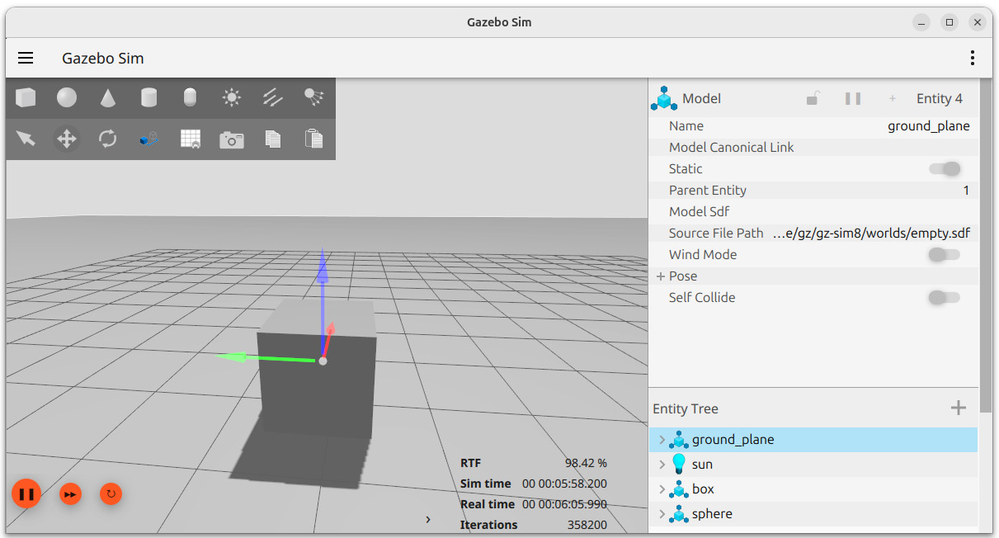
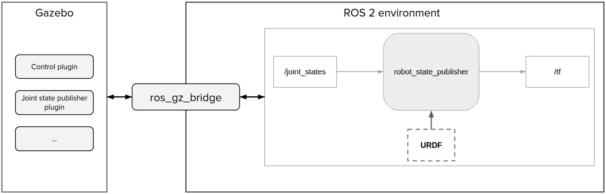
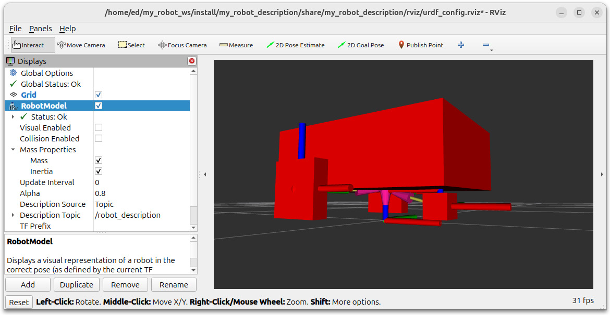
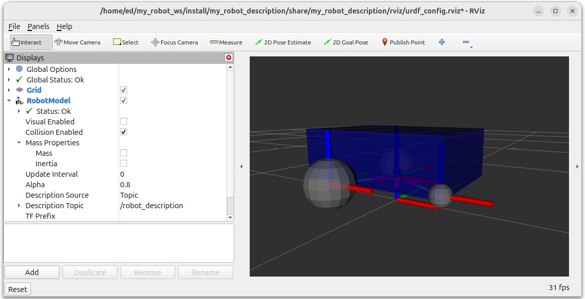
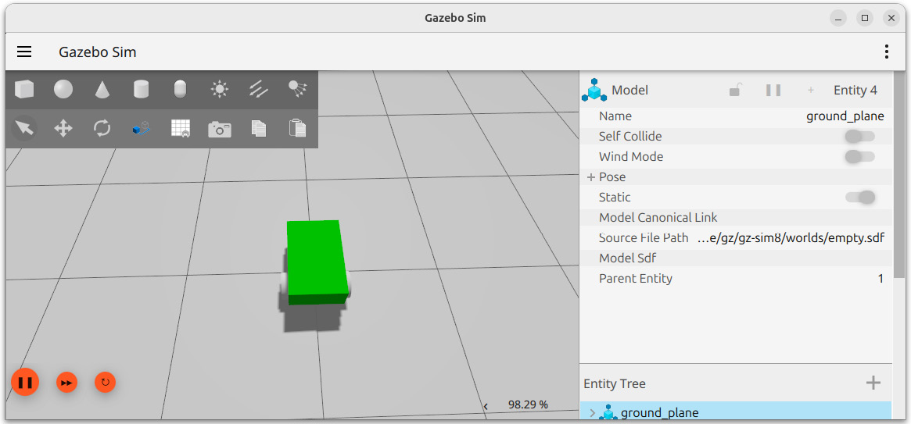
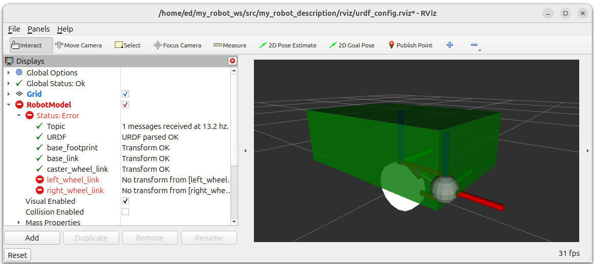

# 13

# Simulating a Robot in Gazebo

In the previous chapters, you wrote a URDF to describe a robot, published the TFs for that robot, and properly organized all files into the **my\_robot\_description** package.

You are now going to simulate the robot in Gazebo. This will be the end of the *Part 3* project. The goal here is to finish the book with a working simulation. After that, I will conclude by giving you some hints on what to do to further with ROS.

We will start the chapter by understanding what Gazebo is, how it is integrated with ROS 2, and how to work with it. This will allow us to adapt the robot URDF for Gazebo, spawn it in the simulator, and control it with a plugin. We will also properly package the application so that we can start everything from one single launch file.

By the end of this chapter, you will be able to simulate a robot in Gazebo and interact with it using ROS 2. After you’ve done the process once, it will be much easier for the next robot you want to simulate.

The level of this chapter is more advanced than what we did before. We will reach a point where the documentation lacks a lot. Finding useful information usually means doing a lot of research on Google, as well as finding GitHub code that works and that you can use as an inspiration.

To complete this chapter, you will also need to utilize what you have previously learned from this book —for example, creating and organizing packages, working with topics and parameters, and writing launch files. Don’t hesitate to refer to previous chapters if you have any doubts.

We will use the code inside the **ch12** folder (on the GitHub repository at <https://github.com/PacktPublishing/ROS-2-from-Scratch>) as a starting point. You can find the final code in the **ch13** folder.

In this chapter, we will cover the following topics:

- How Gazebo works
- Adapting the URDF for Gazebo
- Spawning the robot in Gazebo
- Controlling the robot in Gazebo

# Technical requirements

If you installed ROS 2 in a **VM** (as explained with VirtualBox at the beginning of the book), it probably worked well for all chapters in *Part 1* and *Part 2*, and possibly for the previous chapters in *Part 3*, even when running RViz.

However, with Gazebo, chances are that the VM won’t be enough. VirtualBox doesn’t work well with 3D simulation tools. From now on, I would strongly recommend that you have Ubuntu installed with a dual boot. I know that some people had more success with VMware Workstation (using the free version for personal use) or WSL 2 on Windows. If you find another combination that works for you, fine, but I would still recommend a dual boot, which will possibly be less buggy and bring you a better experience overall.

So, if you are currently running a VM, take the time to set up a dual boot and install Ubuntu 24.04. Then, follow the instructions from [*Chapter 2*](https://learning-oreilly-com.udstlibrary.idm.oclc.org/library/view/ros-2-from/9781835881408/B22403_02.xhtml#_idTextAnchor049) again to install ROS Jazzy. This will take you a bit of time in the short term, but it will surely be more efficient in the long term.

# How Gazebo works

Before we work on our application, it’s important to understand what Gazebo is and how it works.

Gazebo is a 3D simulation engine. It contains a physics engine (with gravity, friction, and other physical constraints) with which you can simulate a robot, just like if it were in the real world.

That’s one of the strengths of Gazebo. You can develop your application using mostly the Gazebo simulation and then work with the real robot. This brings a lot of benefits. For example, you can work on robots that don’t exist yet, test extreme use cases without damaging the real robot, create custom environments you can’t access on a daily basis, work remotely, and so on.

In this section, we will start Gazebo and explore a few functionalities. We will also see how to connect Gazebo with ROS 2 and understand the steps we need to take to adapt our robot for Gazebo. Before getting started with this, a common question that lots of people have at this point is, what is the difference between Gazebo and RViz?

## Clarifying – Gazebo versus RViz

We are starting with this because I believe this is one of the first confusions you can have. We have already used RViz previously, and we could visualize the robot in it, as well as lots of other information. So, why do we need Gazebo?

To understand this, let’s first go back to what RViz is. RViz is a 3D visualization tool. With RViz, you can visualize the URDF, the TFs, and the data you get from ROS topics. This is a great tool to use when developing, as you can check that what you are doing is correct.

Now, RViz **is not** a simulation tool. You don’t simulate anything; you **only visualize** what already exists. So, the robot and all the data you see in RViz is only the representation of what’s happening externally (of RViz). Instead of seeing and interacting with all the data in the terminal, you can do that with a graphical interface and see the data in 3D. That’s (very simply put) what RViz brings to you.

For example, with TFs, RViz will subscribe to the **/tf** topic and display the TFs on the screen. However, RViz doesn’t control the TFs; it just shows them.

Conversely, Gazebo is a simulation tool. It will simulate gravity and the real physical properties of the robot. It also has some control plugins so that you can simulate the hardware control, and even publish the joint states and TFs for your robot.

So, what do we use here—Gazebo or RViz? Ultimately, it’s not a competition; both are complementary.

Gazebo is available if you don’t have a real robot, if you don’t want to use it, or if you want to test a robotics system in a different environment, for example. With Gazebo, you can replicate the behavior of your robot, and make it very close to what it would do in real life.

On top of Gazebo, you can use RViz to visualize the TFs and other important data from your application. RViz is still a very useful tool to have during the development phase. So, the dilemma is not *Gazebo versus RViz*, but instead, *real robot versus Gazebo*. In the end, you can have either:

- Real robot and RViz
- Gazebo simulation and RViz

In this chapter, we will use the second combination. We will spawn and control our robot in Gazebo. Then, we will also visualize it in RViz. What we see in RViz will be a reflection of what’s happening in Gazebo. If, later on, we switched to a real robot, we would ditch Gazebo but still use RViz to see whether everything still works well.

Now that we have made this clarification, we can get started with Gazebo.

## Starting Gazebo

Let’s run Gazebo and get used to the interface.

First, you need to install Gazebo. We installed ROS 2 previously with **ros-<distro>-desktop**, which already contains a lot of packages. To get everything we need for Gazebo, install this additional package:

```
$ sudo apt install ros-<distro>-ros-gz
```

Make sure to replace **<distro>** with your current ROS 2 distribution, and after running this command, source your environment.

Note

Since we are using Ubuntu 24.04, this will install **Gazebo Harmonic**. For other Ubuntu versions, you can find the recommended Gazebo versions here: <https://gazebosim.org/docs/latest/getstarted/>.

It’s important to note that Gazebo is actually independent from ROS 2. You can run Gazebo on its own, without ROS 2. In fact, you could even install Gazebo without any ROS 2 packages.

Gazebo has been designed as an independent robotics simulator that you can then use with ROS 2, as well as other robotics frameworks. Here, I will only focus on ROS 2. The reason I mention this is just to make you understand that Gazebo and ROS are separate projects.

We will start by running Gazebo on its own. Then, we will see how to connect Gazebo and ROS, which will be useful for planning the steps to adapt our project and simulate our ROS robot on Gazebo.

So, to start Gazebo (without ROS), run this command in a terminal:

```
$ gz sim
```

You will be taken to a Gazebo quick-start menu. There, you can click on **Empty** to load an empty world. You also have other existing worlds (click on the different images, or use the search bar) that you can explore later on your own. Warning—some of these worlds may contain bugs and not work properly.

To stop the simulation, press *Ctrl* + *C* in the terminal where you started Gazebo.

When running the Gazebo command, you can also directly specify the world you want to launch. World description files in Gazebo use the SDF format (a file with a **.sdf** extension), which is quite similar to URDF. Let’s start Gazebo with the empty world:

```
$ gz sim empty.sdf
```

Now, take the time to move around the space using mouse controls. You can also use a laptop touchpad, but if possible, I really recommend that you have a mouse, which will make things easier going forward.

At the bottom left of the screen, you will see a play button. Click on it to start the simulation.

After starting the simulation, you will see a percentage at the bottom-right part of the screen, representing the real-time factor. Basically, this will tell you immediately whether your computer is powerful enough for Gazebo. Personally, I have a real-time factor of about 98%, which means that the simulated time in Gazebo keeps up with real time at 98% speed (i.e., after 100 real seconds, 98 seconds have passed in Gazebo). If your percentage is too low, it may be a sign that you need better performance. If you’re not sure, continue with the chapter, and you will quickly see whether the robot simulation works properly or not.

Note

Gazebo can be quite buggy, so don’t be surprised if it crashes at some point—even on a powerful computer. If you can’t close Gazebo properly (with *Ctrl* + *C* in the terminal), you may have some trouble when starting it again. In this case, you can try to stop all Gazebo processes that might still be running in the background. To do that, run **ps aux | grep gz** to find all related processes. You will find a **pid** with four numbers for each **gz** process (if any). To stop a process, run **kill –9 <pid>**. If nothing works, the best thing to do is to restart your computer.

Let’s return to the simulation we started—at the top of the screen, you can click on the different shapes and add them to the empty space. Take some time to experiment with this. Add a box into the space. Find the translation mode and rotation mode. Move the box around (especially on the *z* axis) and see what happens. If you lift the box up, then you should see the box falling down on the floor. This is because of the gravity and physical properties of the box.



Figure 13.1: The Gazebo simulator with a box in an empty world

What we can do next is explore the communications used by Gazebo. Gazebo also uses topics and services, but those are not the same as ROS 2 topics and services.

For example, you can list all Gazebo topics with this command:

```
$ gz topic -l
```

You will see a lot of topics, but if you try to run **ros2 topic list** in another terminal, none of those topics will appear. Also, when running **ros2 node list**, you won’t see any nodes.

With this, you can see that Gazebo is completely independent of ROS 2, and they do not interact with each other.

## How Gazebo works with ROS 2

We will now explore how Gazebo and ROS 2 can be connected.

First of all, you can start Gazebo using a ROS 2 launch file from the **ros\_gz\_sim** package. This will be more practical for us because when we write our own launch file, we can include this one:

```
$ ros2 launch ros_gz_sim gz_sim.launch.py
```

This will start Gazebo the same way we did with the **gz sim** command. You can also specify the world to launch with the **gz\_args** argument:

```
$ ros2 launch ros_gz_sim gz_sim.launch.py gz_args:=empty.sdf
```

However, even if we started Gazebo from a ROS 2 launch file, Gazebo is still independent. Try to list all the nodes and topics in a terminal; you will see the same result as before.

To connect Gazebo and ROS 2 topics (or services), you need to create a bridge between them. The **ros\_gz\_bridge** package does that for us, so we will use this package. We will only need to provide some configuration to specify which topics we want to bridge; how to write this configuration will be covered later in the chapter.



Figure 13.2: Connecting Gazebo and ROS 2 with ros\_gz\_bridge

In *Figure 13**.2*, you can see the following:

- On the right, our current ROS 2 application with the **robot\_state\_publisher** node, publishing on the **/****tf** topic.
- On the left, **Gazebo**. Inside **Gazebo**, we will add plugins (also called systems) to simulate the hardware behavior of the robot. For example, you could have one plugin to control the two wheels, and one plugin to publish the joint states for the wheels. This is what we will implement in this chapter.
- Then, to make everything work together, we will use the **ros\_gz\_bridge** package. With the joint state example, the Gazebo Joint state publisher plugin will publish the joint states with a Gazebo topic. Using **ros\_gz\_bridge**, we will match this topic with the ROS 2 **/****joint\_states** topic.

The important thing to understand here is that Gazebo and ROS 2 exist in two different environments, but you can make them work together. Your ROS 2 application will be the same, whether you work on a Gazebo simulation or a real robot. If you work on a real robot, then you would directly control the wheels and get the joint state data from encoders. With Gazebo, you use plugins to simulate the hardware.

Now, here are the steps we will take in the following sections to create the Gazebo simulation for our robot:

1. Adapt the URDF for Gazebo. For a robot to work on Gazebo, we first need to provide inertial and collision properties in the URDF.
2. Once the URDF is correct, we will start Gazebo and spawn the URDF in it. At this point, we will also create a package with a launch file.
3. We will then add some plugins (systems) to control the robot, using the **ros\_gz\_bridge** package to make those plugins communicate with our ROS 2 application.

You can follow this process for basically any ROS 2 robot you want to simulate in Gazebo. If some things are still not clear, continue with the chapter, work on the implementation, and come back to this section at the end. Everything will make more sense.

Let’s start with the first step.

# Adapting the URDF for Gazebo

We could try to spawn our robot directly into Gazebo, but it won’t work, as the URDF is missing two key elements—inertial and collision properties. Gazebo needs those to correctly simulate a robot.

Thus, before we do anything with Gazebo, we need to come back to our URDF and add those properties. For each link of the robot that represents a physical part, we will add an **<inertial>** tag and a **<collision>** tag. In this section, you will learn how to properly configure those.

We will modify the URDF we created in the **my\_robot\_description** package. As a quick recap, this package contains the URDF, a launch file to display the robot model in RViz, and an RViz configuration. The most important thing in this package is the URDF. The launch file will help us validate that the values we set in the URDF are correct.

Let’s start with the inertial properties and then add the collision ones.

## Inertial tags

A URDF without inertial properties won’t load in Gazebo. Thus, this is the first thing you need to add.

An **<inertial>** tag will contain a few elements, including a 3x3 matrix representing an inertia tensor. In this book, we won’t dive into the theoretical inertia details; you can look that up on your own if you want, as there is pretty good documentation on the internet. Instead, we will focus on finding the correct formulas and applying them, allowing us to spawn the robot and quickly move on to the next steps.

So, currently, our URDF is split into three files. We will add some code to those files:

- **common\_properties.xacro**: Here, we will add some macros to specify the inertial properties for a box, a cylinder, and a sphere. This way, we only need to write the inertial formulas once for those shapes, and you can reuse them in any of your projects.
- **mobile\_robot.xacro**: Inside each link representing a physical part, we will use the corresponding inertial macro we defined previously.
- **my\_robot.urdf.xacro**: Nothing changes here; we still import the two previous files.

Now, how do we write the inertial macros for the shapes we have in our URDF?

### What do we write inside an <inertial> tag?

We will create three Xacro macros containing an **<inertial>** tag—one for a box, one for a cylinder, and one for a sphere. Inside a URDF **<inertial>** tag, you will need to provide:

- The mass of the element (in kg).
- The origin for the inertia (in meters and radians).
- The nine elements of the inertia tensor, or matrix (in kg per sqm). Since the matrix is symmetrical, we only need six elements—**ixx**, **ixy**, **ixz**, **iyy**, **iyz**, and **izz** (for example, **ixy** and **iyx** are the same, so we omit the second one).

As we don’t have a physical robot for this project, we will arbitrarily decide on a mass property for each link—while, of course, trying to have values that make sense.

Now, how do we compute the inertia matrix? This is usually the hardest part when writing the **<****inertial>** tags.

If you are designing your robot with CAD software—for example, with **SolidWorks**—then you can export each property directly from the software and add them to your URDF. As we don’t have this software, we will need to make the computation ourselves.

Fortunately, there are some helpful resources on the internet. You can find a list of moments of inertia on Wikipedia: <https://en.wikipedia.org/wiki/List_of_moments_of_inertia>. There, you can also find the moment of inertia for each simple shape that we have, as well as a list of 3D inertia tensors, which are basically the matrices we need for the URDF. One thing to note is that the matrices only have three non-zero components—**ixx**, **iyy**, and **izz**. All the other components are set to **0**.

With this information, we can start writing the **<****inertial>** tags.

### Adding inertial macros for basic shapes

As the inertial macros for basic shapes could be used by any robot, we will add all macros in the **common\_properties.xacro** file. This way, if you want to create another URDF for another robot, you can just reuse this Xacro file.

The first macro will be for a box inertia. Now, if you look at the preceding Wikipedia link, things could be a bit confusing, as they use **width**, **depth**, and **height** (*w*, *d*, and *h*). In ROS 2, we have specified the length, width, and height for the *x*, *y*, and *z* dimensions. Which one corresponds to which?

One easy way to write this matrix properly is to realize that one component for one dimension uses the two other dimensions. For example, to compute the *w* component (**ixx** in the matrix), we use *h* (*z*) and *d* (*y*). Only following this can remove a lot of confusion, especially with the different naming conventions.

Here is what we will use (on the left, the Wikipedia value, and on the right, the ROS 2 value):

- **w**: the *x* dimension
- **d**: the *y* dimension
- **h**: the *z* dimension (this is also the axis pointing up)

Here is the **<inertial>** tag for a box. You can add this after the **<material>** tags, inside the **<****robot>** tag:

```
<xacro:macro name="box_inertia" params="m x y z o_xyz o_rpy">    <inertial>        <mass value="${m}" />        <origin xyz="${o_xyz}" rpy="${o_rpy}" />        <inertia ixx="${(m/12) * (z*z + y*y)}" ixy="0" ixz="0"                 iyy="${(m/12) * (x*x + z*z)}" iyz="0"                 izz="${(m/12) * (x*x + y*y)}" />    </inertial></xacro:macro>
```

To make it simple, I used **x**, **y**, and **z** directly (instead of *w*, *d*, and *h*), which will make things easier when we need to use the macro in our links, where the box dimensions are defined with **x**, **y**, and **z**. When you develop an API/interface/macro/function, the best practice is to design the interface for the client of the API, not for the developer who’s writing the API.

Let’s now write the macro for a cylinder. This one is a bit easier. We have two components—radius and height. This will correspond to the radius and length we defined in the URDF:

```
<xacro:macro name="cylinder_inertia" params="m r l o_xyz o_rpy">    <inertial>        <mass value="${m}" />        <origin xyz="${o_xyz}" rpy="${o_rpy}" />        <inertia ixx="${(m/12) * (3*r*r + l*l)}" ixy="0" ixz="0"                 iyy="${(m/12) * (3*r*r + l*l)}" iyz="0"                 izz="${(m/2) * (r*r)}" />    </inertial></xacro:macro>
```

Finally, we can write the macro for a (solid) sphere. This is the easiest, and we only have one component —the sphere radius:

```
<xacro:macro name="sphere_inertia" params="m r o_xyz o_rpy">    <inertial>        <mass value="${m}" />        <origin xyz="${o_xyz}" rpy="${o_rpy}" />        <inertia ixx="${(2/5) * m * r * r}" ixy="0" ixz="0"                 iyy="${(2/5) * m * r * r}" iyz="0"                 izz="${(2/5) * m * r * r}" />    </inertial></xacro:macro>
```

With those three macros, we have everything we need for all the basic URDF shapes.

### Including the inertial macros in the links

We can now use those macros to provide the inertial property for each link of the robot.

As the **base\_footprint** doesn’t represent a physical part (it’s what we call a virtual link), it won’t have an inertia. For all the other links (base, right wheel, left wheel, and sphere), we will use the inertial macros.

Open the **mobile\_base.xacro** file, which is where we will continue with the code.

Now, to add the inertial property for a link, you need to add an **<inertial>** tag inside the **<link>** tag. To add this tag, we will use the macros we previously created.

Let’s start with **base\_link**. Inside the **<link name="base\_link"></link>** tag, and after the **<visual>** tag, add the **box\_inertia** macro:

```
<xacro:box_inertia m="5.0" x="${base_length}" y="${base_width}" z="${base_height}" o_xyz="0 0 ${base_height / 2.0}" o_rpy="0 0 0" />
```

Note

Both the **<visual>** and **<inertial>** tags are children of the **<link>** tag; do not add the **<inertial>** tag inside the **<****visual>** tag.

We specify all the parameters required for the macro:

- **Mass**: Here, we decided that the box would be **5.0** kg.
- **Box properties**: The **x**, **y**, and **z** dimensions (we have created the macro so that we can use the ROS 2 axis system convention).
- **Inertia origin**: The inertia is related to the box itself, so if the box has an offset relative to the joint origin, you need to take this offset into account. Basically, you can use the same values you wrote in the visual origin. If you are confused, don’t worry—after adding the **<inertial>** tags, we will verify the inertia in RViz. There, you can easily see whether the inertia is correctly placed.

Now, add the inertia for the two wheels. You will add the **cylinder\_inertia** macro inside the **wheel\_link** macro (it’s perfectly fine to use a macro within another macro). Make sure to place it inside the **<link>** tag and after the **<visual>** tag. This inertia macro will apply to both wheels:

```
<xacro:cylinder_inertia m="1.0" r="${wheel_radius}" l="${wheel_length}" o_xyz="0 0 0" o_rpy="${pi / 2.0} 0 0" />
```

Here are the parameters we specify:

- **Mass**: Set the mass for each wheel to **1.0** kg.
- **Cylinder properties**: The radius and length of the cylinder.
- **Inertia origin**: The visual is centered around the link origin, so we don’t need to add any offset. However, to match the image on the Wikipedia page, we have defined the macro for the inertia of a cylinder with the rotation axis as the **z** axis. The wheels’ visual has been shifted by 90° on the **x** axis so that the rotation axis becomes the **y** axis. Here, we provide the same rotation for the origin. Basically, once again, you can use the same values you wrote in the visual origin.

Finally, we add the **sphere\_inertia** macro for **caster\_wheel\_link**:

```
<xacro:sphere_inertia m="0.5" r="${wheel_radius / 2.0}"    o_xyz="0 0 0" o_rpy="0 0 0" />
```

This one is quite easy. We choose **0.5** kg for the mass, and then we provide **radius**, which is the only sphere property. We don’t need to specify any offset for the origin.

That’s it for the **<inertial>** tags. The main difficulty was to define the macro for the simple shapes (but you only need to do this once), and then to correctly use the macros and provide the correct origin. Let’s now verify that we provided the correct dimension values and origins, using RViz.

### Validating inertia with RViz

To make sure that the inertial property is correct for each link, you can use RViz. As we already have created a launch file inside the **my\_robot\_description** package, let’s use it to visualize the URDF in RViz.

Don’t forget to build and source the workspace before you start RViz. Then, start the launch file:

```
$ ros2 launch my_robot_description display.launch.xml
```

You will see the same view and configuration from the previous chapter. To see the inertia, first disable the visual. On the left menu, open **RobotModel** and uncheck **Visual Enabled**. Then, still inside **RobotModel**, open **Mass Properties** and check the **Inertia** box. You should see something like this:



Figure 13.3: Visualizing inertia in RViz

With this view, you can easily spot errors. For example, if the offset for the **base\_link** inertia is not right, then the box will not be correctly placed. Another common error will be in the rotation of the wheel inertia. In the preceding figure, you can see that the inertia box is more or less on top of the wheel, correctly orientated. If that’s not the case, you know you have to fix the inertia in the code.

Once you are done with the **<inertial>** tags, you can add the **<****collision>** tags.

## Collision tags

So far, inside each link of our URDF, we have a **<visual>** tag to see the link and an **<inertial>** tag to describe the physical properties for Gazebo.

However, there is something missing. The visual is only for you to visualize the link in RViz or Gazebo. However, Gazebo needs more than this to simulate the robot. You will have to add **<collision>** tags to the links so that Gazebo can compute how two parts collide with each other.

To give you an idea, if you don’t have any collision property for your robot, then the robot will fall through the ground and continue falling indefinitely. With a collision property, the robot will *collide* with the ground and, thus, not fall. On top of that, that property will be used to compute collisions between different parts of the robot, or collisions with other robots and elements in an environment. For example, if the robot collides with a wall or an object, it will bump into it and not go through it. Once again, the **<visual>** tag doesn’t do any of this.

Before we write the **<collision>** tags for our robot, let’s understand how to define a collision.

### How to define a collision element

A **<collision>** tag will contain more or less the same thing as a **<visual>** tag: **<geometry>** and **<origin>** tags. You will basically define a shape.

As a general rule, for a collision, you will use a simpler shape than for the visual (if possible). The reason is simple—the more complex the shape, the more computation power will be required to compute the collision between the link and other elements. This could slow down the simulation a lot. Thus, designing simpler shapes is a best practice.

Here are a few more details about defining a collision element:

- If you are using complex Collada files (a few MB) for visuals, use simpler Collada or even STL files for the collisions. You can add those files to the **meshes** folder and include them in the URDF.
- If the shape is close to a basic one (a box, cylinder, or sphere), then you can use a basic shape for the collision. For example, if you design a mobile robot and the base of the robot looks like a box, then you can use a complex Collada or STL file for the visual, only using a box for the collision. For a wheel, you can use a cylinder, sphere, and so on.
- Even when using basic shapes, you could reduce the complexity—for example, by using a box for a collision when the visual is a cylinder or a sphere (however, we will see an exception to this later in this section in order to reduce friction in Gazebo).

To find real examples of this shape simplification, you can simply search on GitHub for existing projects. Find a robot powered by ROS 2, and type **<name of the robot>** + **description** + **github** into Google—you can try with the *TurtleBot 3* (or a more recent version) robot. You will usually find a package similar to the one you created in the previous chapter. In this package, search for the URDF or Xacro files, and find the **<collision>** tags. You will often see that the collision uses a simplified STL file or a basic URDF shape.

Now that we have this simplification mindset, let’s add the **<collision>** tags inside the URDF.

### Adding collision properties for the links

You will add **<collision>** tags inside the **<link>** tags, in the **mobile\_base.xacro** file.

Pay attention to where you add those tags. They should be at the same level as the **<visual>** and **<inertial>** tags, not inside them. The order doesn’t really matter, but to keep things clean, I usually start with **<visual>**, then **<collision>**, and finally, **<inertial>**.

Here is the **<collision>** tag for **base\_link**:

```
<collision>    <geometry>        <box size="${base_length} ${base_width} ${base_height}" />    </geometry>    <origin xyz="0 0 ${base_height / 2.0}" rpy="0 0 0" /></collision>
```

A box is already the simplest shape you can have, so we just use another box. Then, we set the same dimensions and origin as for the visual. As you can see, adding the collision for this link basically means copying and pasting the content of the **<visual>** tag (except for **<material>**).

Now, for the two wheels, the situation is a bit unique. They are cylinders, so it’s a quite basic shape. We could keep the same, or even use a box, which is much simpler.

However, those wheels will be in direct contact with the floor in Gazebo. Using a box is not a good idea—imagine a car with square wheels; it’s probably not going to work well.

We could keep a cylinder, which is the second most simple shape, but if you do this, you might experience some unwanted friction later on in Gazebo, which will result in the robot not moving exactly how we want. For wheels that you control and that touch the floor, it’s best to use a sphere for the collision, as this reduces the number of contact points with the ground (basically, just one contact point) and, thus, reduces the unwanted friction.

Note

This is more of a Gazebo *hack* than a real logical choice. Let’s be clear here—there is no way you can come up with this conclusion at this point; it’s something you have to experience in Gazebo and fix later. I’m not a big fan of such hacks, but sometimes, you don’t have a choice. Also, I’m giving you the correct solution beforehand to not make this chapter too long.

Let’s add a sphere collision for our wheels, inside the **wheel\_link** macro:

```
<collision>    <geometry>        <sphere radius="${wheel_radius}" />    </geometry>    <origin xyz="0 0 0" rpy="0 0 0" /></collision>
```

We just use the wheel radius property; there is no need for the wheel length here. And since it’s a sphere, there’s no need to add any rotation for the origin.

Finally, we add the collision for the caster wheel. As stated before, we could simplify the sphere with a box, but as the caster wheel is in direct contact with the ground, we don’t want to add unwanted friction. Thus, we use the same sphere for the visual and the collision:

```
<collision>    <geometry>        <sphere radius="${wheel_radius / 2.0}" />    </geometry>    <origin xyz="0 0 0" rpy="0 0 0" /></collision>
```

That’s it for the **<collision>** tags. The URDF for our mobile robot is now complete.

### Validating collision with RViz

As with everything we have written in the URDF, you can also visualize the collision properties in RViz.

Build your workspace, source the environment, and start the **display.launch.xml** launch file again.

Open the **RobotModel** menu and uncheck the **Visual Enabled** box. Then, check the **Collision** **Enabled** box.



Figure 13.4: Visualizing collision in RViz

There, you can see whether the collision properties are correct. In the **Links** menu (inside **RobotModel**), you can enable only some links if necessary, giving you a more precise view.

If you see that some collision elements are not correctly placed, or if they are too big or too small, you can then go back to your URDF and fix them.

As you can see in the preceding figure, the collision view for the robot is almost the same as the visual. The difference is with the wheels, which are now spheres. You might also wonder, if the wheels are spheres, a part of them is inside the box, and thus they will collide with the box. That’s true, but this collision between adjacent links will not be taken into account by Gazebo.

Now that you’ve added both the **<inertial>** and **<collision>** tags, we can go to the next step and spawn the robot in Gazebo.

# Spawning the robot in Gazebo

The first step of adapting the URDF for Gazebo was crucial, as without this, the robot either wouldn’t appear on Gazebo or behave incorrectly.

Now that the URDF is done (and has been verified in RViz), we can spawn the robot in Gazebo. In this section, you will see what commands you need to run, and then we will create another package with a launch file to start everything.

Here is what we will do:

1. Run the **robot\_state\_publisher** node with the URDF as a parameter.
2. Start the Gazebo simulator.
3. Spawn the robot in Gazebo.

Let’s start this with the terminal commands.

## Spawning the robot from the terminal

As usual, before creating a launch file, we will run each command one by one in different terminals, enabling us to clearly understand what we need to run, with all the necessary details.

Open three terminals to start all the commands.

The first thing to start is the **robot\_state\_publisher** node. This is what we did in [*Chapter 12*](https://learning-oreilly-com.udstlibrary.idm.oclc.org/library/view/ros-2-from/9781835881408/B22403_12.xhtml#_idTextAnchor575), and this is also usually the first thing you will start in any ROS 2 application.

In Terminal 1, run the following command:

```
$ ros2 run robot_state_publisher robot_state_publisher --ros-args -p robot_description:="$(xacro /home/<user>/my_robot_ws/src/my_robot_description/urdf/my_robot.urdf.xacro)"
```

This is the same as in the previous chapter. We pass the URDF with the **robot\_description** parameter.

After executing this command, the **robot\_state\_publisher** node starts and does three things—subscribes to **/joint\_states**, publishes on **/tf**, and also publishes the URDF on **/robot\_description**. You can verify this with **rqt\_graph** if needed (in this case, make sure to uncheck the **Dead sinks** and **Leaf** **topics** boxes).

In a second terminal, we start Gazebo. In fact, you could start Gazebo before **robot\_state\_publisher**; the order doesn’t matter for those first two steps.

In Terminal 2, run the following command:

```
$ ros2 launch ros_gz_sim gz_sim.launch.py gz_args:="empty.sdf -r"
```

With this, we start an empty world in Gazebo. By default, the time is stopped when you launch Gazebo. We add the **-r** option to start the time directly so that we don’t have to click the play button.

Finally, once you have done the first two steps, you can spawn the robot in Gazebo. For this, we will use the **create** executable from the **ros\_gz\_sim** package. This will spawn a robot in Gazebo, using the URDF of the robot, which we can pass as a topic with the **-topic** option. As the **robot\_state\_publisher** node publishes the URDF on the **robot\_description** topic, we can use this topic.

In Terminal 3, run the following command:

```
$ ros2 run ros_gz_sim create -topic robot_description
```

After running this command, you should see the robot in Gazebo:



Figure 13.5: The robot spawned in Gazebo

If you get any error in any terminal, it probably means that your URDF is not correct. In this case, go back to the Xacro files and double-check everything.

Note

To see the importance of the **<inertial>** and **<collision>** tags, go back to the URDF, comment the inertia for the wheels, and then run the commands again. You will see that the wheels do not appear in Gazebo. Then, put the inertia back and comment the collision for the wheels. This time, the wheels will appear, but as they do not collide with the ground, you will see them going into the ground.

Now that we know which commands to run, let’s write a launch file.

## Spawning the robot from a launch file

We are now going to write a launch file to start those three commands. This will be a good base on which we can add more things later on.

Let’s start by creating a new package in our workspace.

### Creating a \_bringup package

If you remember what we did in [*Chapter 9*](https://learning-oreilly-com.udstlibrary.idm.oclc.org/library/view/ros-2-from/9781835881408/B22403_09.xhtml#_idTextAnchor444), the best practice is to create a dedicated package for launch files and configuration files (we don’t have any configuration files yet, but we will add one later in this chapter).

We made an exception for the **display.launch.xml** file, which we placed inside the **my\_robot\_description** package. As explained in [*Chapter 12*](https://learning-oreilly-com.udstlibrary.idm.oclc.org/library/view/ros-2-from/9781835881408/B22403_12.xhtml#_idTextAnchor575), this launch file is only used during development to visualize the URDF. Thus, it makes sense to have the launch file in the same package as the URDF. Here, and for any future launch and configuration files in our application, we will use a new dedicated package.

Following the naming convention for such a package, we will start with the name of the robot or application, adding the **\_bringup** suffix. Thus, we will create the **my\_robot\_bringup** package.

Note

Be careful not to confuse this package with the **my\_robot\_bringup** package in the **ros2\_ws** we created in *Part 2* of the book. Here, in *Part 3*, we are using another workspace, named **my\_robot\_ws**, so the **my\_robot\_bringup** package is a completely different one.

Let’s create this package, remove the unnecessary folders, and add a **launch** folder. We will also add a **config** folder, which we will use later in the chapter:

```
$ cd ~/my_robot_ws/src/$ ros2 pkg create my_robot_bringup --build-type ament_cmake$ cd my_robot_bringup/$ rm -r include/ src/$ mkdir launch config
```

Now, in the **CMakeLists.txt** file of the **my\_robot\_bringup** package, add the instruction to install the **launch** and **config** folders:

```
install(  DIRECTORY launch config  DESTINATION share/${PROJECT_NAME}/)
```

The package is correctly set up, so we can now add and install files.

### Writing the launch file

Let’s create, write, and install the launch file to spawn the robot in Gazebo.

First, create a new file inside the launch folder. As this launch file will be the main one, let’s simply use the name of the robot (or robotics application), **my\_robot.launch.xml**:

```
$ cd ~/my_robot_ws/src/my_robot_bringup/launch/$ touch my_robot.launch.xml
```

Open the file and write the minimal code for an XML launch file:

```
<launch></launch>
```

Then, inside this **<launch>** tag, let’s add everything we need, step by step.

The beginning of the launch file will be very similar to the **display.launch.xml** file that we wrote in the previous chapter, so we can basically copy and paste a few parts. We start by adding a variable for the path to the URDF file:

```
<let name="urdf_path" value="$(find-pkg-share my_robot_description)/urdf/my_robot.urdf.xacro" />
```

Now, we can start the **robot\_state\_publisher** node:

```
<node pkg="robot_state_publisher" exec="robot_state_publisher">    <param name="robot_description"           value="$(command 'xacro $(var urdf_path)')" /></node>
```

Then, we start Gazebo with an empty world, and we also use the **-r** option to start the time automatically:

```
<include    file="$(find-pkg-share ros_gz_sim)/launch/gz_sim.launch.py">    <arg name="gz_args" value="empty.sdf -r" /></include>
```

Finally, we spawn the robot in Gazebo:

```
<node pkg="ros_gz_sim" exec="create" args="-topic robot_description" />
```

That’s it for the launch file for now. Later, we will add more things and also start RViz to visualize the TFs. For now, we just want to see the robot in Gazebo.

There is one thing we can do to make things a bit cleaner—as we are using files, nodes, and launch files from other packages, let’s add a dependency to them in the **package.xml** file of the **my\_robot\_bringup** package. After the **<buildtool\_depend>** line, add these lines:

```
<exec_depend>my_robot_description</exec_depend><exec_depend>robot_state_publisher</exec_depend><exec_depend>ros_gz_sim</exec_depend>
```

We use the less strict **<exec\_depend>** tag instead of **<depend>**, as we only require those dependencies to run the launch file, not to compile any code. With this, if, for example, you didn’t install the **ros\_gz\_sim** package and you try to build the **my\_robot\_bringup** package, you will get an error when running **colcon build**, and then you can fix things right away. Without those lines, the build would work, but you would then get an error when starting the launch file, which can be a big problem, especially in a production environment. So, the best practice is to specify all the dependencies you need in the **package.xml** file.

Now, save all the files, build the workspace, source the environment, and start the launch file (make sure that Gazebo is not running in another terminal before you do this):

```
$ ros2 launch my_robot_bringup my_robot.launch.xml
```

You should get the same result as when we ran all three commands in the terminal.

# Controlling the robot in Gazebo

Our mobile robot is now simulated in Gazebo with physics properties. Now what? The robot is not doing anything. We will finish this chapter by adding control plugins so that we can simulate the hardware of the robot and do the following:

- Send commands to make the robot move in Gazebo, just as if it were in the real world
- Read all necessary joint states from the robot to get all the TFs in our ROS 2 application

Before we start discussing Gazebo systems and bridges, let’s dive a little bit deeper and understand what’s missing and what we need to add.

## What do we need to do?

When you start the **my\_robot.launch.xml** launch file, you see the robot in Gazebo. However, we don’t have any way to control it. In a terminal, if you list all nodes, topics, services, or even actions, you won’t find anything we can use.

Also, after starting the launch file, if you print the TF tree, you won’t see the TF for the right or left wheel. You can observe the same thing with RViz—to make things simple, you can start RViz using the previous configuration we saved:

```
$ ros2 run rviz2 rviz2 -d ~/my_robot_ws/src/my_robot_description/rviz/urdf_config.rviz
```

You should see some errors in **RobotModel**, saying **No transform from [left\_wheel\_link]** and **No transform** **from [right\_wheel\_link]**.



Figure 13.6: TF errors in RViz after spawning the robot in Gazebo

This lack of TF is because nobody is publishing on the **/joint\_states** topic. In [*Chapter 12*](https://learning-oreilly-com.udstlibrary.idm.oclc.org/library/view/ros-2-from/9781835881408/B22403_12.xhtml#_idTextAnchor575), when we were just visualizing the robot model, we used a fake joint state publisher. We won’t do this here.

So, what do we need to do?

For a real robot, you would create a hardware driver to be able to control the wheels. This driver would expose a topic/service/action interface so that you could make the robot move. Then, you would read position/velocity data from encoders and publish this data on the **/joint\_states** topic. With this, the loop is closed.

For a Gazebo simulation, we will do the same thing but, of course, without hardware. We will use Gazebo plugins (also called systems) to simulate the control of the robot and get the joint states. Then, we will configure a *bridge* to make those plugins communicate with our ROS 2 application.

Let’s start with the Gazebo systems.

## Adding Gazebo systems

A Gazebo system is basically the simulation of a hardware component. You could have a system simulating a camera and publishing images, another one monitoring a battery state, and so on. For this book, we will use two systems—one to control a differential drive robot (two parallel wheels), and one to publish the joint states.

Now, the good news is that there are a lot of existing systems already available to use, including the two that we need.

The bad news is that documentation for those systems is almost non-existent (at the time of writing), and you will have to dive into the code itself to find what to include in your own code. Don’t worry about that—we will do this process step by step, and it is replicable for any other system that you use.

For Gazebo Harmonic and ROS 2 Jazzy, you can find all available Gazebo systems here on GitHub: <https://github.com/gazebosim/gz-sim/tree/gz-sim8/src/systems> (for other Gazebo versions, you might have to use a different branch).

Note

If there was not enough confusion already, on the internet you will often see the term *plugin* or *system*; they both refer to the same thing. Even if the word *system* should be preferred, in practice it’s not clear which one to use; for example, to include a system in our code, we will need to use a **<plugin>** tag. So, in this section, I will have to use both terms.

Now, where are we going to add our systems for the robot we want to simulate? We will do this in the URDF.

### Xacro file for Gazebo

The Gazebo systems for our robot will be specified in the URDF. So, we need to return to the **my\_robot\_description** package.

Our URDF is now split into three files: one with common properties, one with the description of the robot (links and joints), and one to include the other two.

To add the Gazebo systems, we will create yet another Xacro file, dedicated to all Gazebo-related stuff. By separating this file from the other ones, we make things cleaner. If, later on, you want to use the URDF without Gazebo, you only need to remove the inclusion of the Gazebo file.

In the **urdf** folder of your **my\_robot\_description** package, add a fourth file, named **mobile\_base\_gazebo.xacro**.

Open the file and add the minimal Xacro code:

```
<?xml version="1.0"?><robot xmlns:xacro="http://www.ros.org/wiki/xacro"></robot>
```

Now, in **my\_robot.urdf.xacro**, include the file after the two other ones:

```
<xacro:include filename="$(find my_robot_description)/urdf/mobile_base_gazebo.xacro" />
```

The Xacro file is ready, and we can now add the systems.

### Differential drive controller

The first system we will add is a **differential drive controller**. By differential drive, we mean a robot controlled by two wheels, one on each side of the robot.

If you browse the available systems (the link is provided on the preceding page), you can find a **diff\_drive** folder—usually in ROS, we use **diff drive** as an abbreviation of **differential drive**.

In this folder, you will see a **DiffDrive.hh** file. Open this file, and there, near the beginning, you will find the XML tags related to the system (it’s possible that some tags will be missing here; for some systems, you might have to read the complete source code to find all available tags).

Here is how to add the system to our Xacro file (**mobile\_base\_gazebo.xacro**):

```
<gazebo>    <plugin        filename="gz-sim-diff-drive-system"        name="gz::sim::systems::DiffDrive">        <left_joint>base_left_wheel_joint</left_joint>        <right_joint>base_right_wheel_joint</right_joint>        <frame_id>odom</frame_id>        <child_frame_id>base_footprint</child_frame_id>        <wheel_separation>0.45</wheel_separation>        <wheel_radius>0.1</wheel_radius>    </plugin></gazebo>
```

We start with a **<gazebo>** tag. Everything related to Gazebo will be in such tags. Then, we include the system with a **<plugin>** tag. We also need to specify the filename and name for the system.

Note

Usually, the filename and name will follow this syntax:

**-** **Filename**: **gz-sim-<name-with-dashes>-system**

**- Name**: **gz::sim::systems::<UpperCamelCaseName>** (you can also find the name at the bottom of the **.cc** file of the system)

Here is a bit more information about the different parameters for this diff drive system:

- **left\_joint** and **right\_joint**: You need to provide the exact name of the joints you have defined for the wheels in the URDF.
- **frame\_id**: As the robot moves, we will keep track of where it is relative to its starting position. This starting position will be called **odom** (short for **odometry**).
- **child\_frame\_id**: We write **base\_footprint**, as it is the root link for our robot and the one we want to use for odometry tracking.
- **wheel\_separation**: We can compute that from the URDF. The base width is 0.4, and the origin for each wheel is centered on the wheel. As each wheel length is 0.05, we need to add 0.4 + 0.025 + 0.025, which makes **0.45**.
- **wheel\_radius**: We get this value from the URDF, which is defined as **0.1**.
- Acceleration and velocity min and max: Optionally, you can set some limits. This can be a good idea so that the controller doesn’t accept a command that would make the robot move too fast and, potentially, become dangerous to itself or an environment. For the values, once again, you should use the metric system and radians for angles.

That’s it for the diff drive system. Now, in addition, there is one setting we need to add for the caster wheel. If you remember, the caster wheel is a passive joint, so we defined it as a fixed sphere.

As the wheels turn and the robot moves, there will be some friction between the ground and the caster wheel. You won’t see the friction that much in Gazebo, but it will slow down the robot a bit, and later on, if you visualize the robot in RViz, you won’t have the same result.

So, we will reduce the friction for the caster wheel. You can add this code just before the code for the diff drive system:

```
<gazebo reference="caster_wheel_link">    <mu1 value="0.1" />    <mu2 value="0.1" /></gazebo>
```

There are two parameters, **mu1** and **mu2**, that you can set to have more control over the friction. I have chosen the value **0.1**; later, you could reduce this value even more.

### Joint state publisher

We have added a system to control the wheels, but before we test it, let’s finish the Xacro file and add the second system we need. The diff drive system alone won’t publish the joint states for the wheels; we need to add a joint state publisher system.

Go back to the systems page on GitHub, and you will find a **joint\_state\_publisher** folder. In this folder, you can get the *documentation* for the XML tags in the **JointStatePublisher.hh** file.

Let’s add the system to the Xacro file, after the previous one:

```
<gazebo>    <plugin        filename="gz-sim-joint-state-publisher-system"        name="gz::sim::systems::JointStatePublisher">    </plugin></gazebo>
```

The joint state publisher system is easier to set up. Also, we don’t specify any **<joint\_name>** tag here to publish all available joint states. If your robotics system contains a lot of joints, it could be useful to only specify the joints you want to use.

Our **mobile\_base\_gazebo.xacro** file is now complete, and we won’t need to modify anything else in the URDF. We can spawn the robot in Gazebo again and see how it interacts with those systems.

## Bridging Gazebo and ROS 2 communications

The last thing we need to do, for this simulation to be complete, is to bridge Gazebo and ROS 2 communications.

Let’s first understand what’s missing.

### What topics do we need to bridge?

If you remember, we talked about this at the beginning of the chapter. Gazebo uses topics and services, but those are independent from ROS 2. Thus, the systems we have just added will work, but they will only have a Gazebo interface.

You can verify this by starting the **my\_robot.launch.xml** file again—make sure to compile and source the workspace beforehand so that you get the updated URDF.

Then, in another terminal, list all Gazebo topics. The list will contain quite a lot of things; here, I only include the ones that we will use:

```
$ gz topic -l/model/my_robot/tf/world/empty/model/my_robot/joint_state/model/my_robot/cmd_vel
```

The first topic that ends with **/tf** will contain the TF from the **odom** frame to **base\_footprint**. The one with **/joint\_state** will contain the joint states for both wheels, and the topic with **/cmd\_vel** will be used to send a velocity command to the robot.

However, if you check the ROS 2 topics with **ros2 topic list**, you won’t see the **/cmd\_vel** topic. You will have **/joint\_states** and **/tf**, but only because the **robot\_state\_publisher** node creates a subscriber and publisher for those topics. Nothing is published; you can verify this with **ros2 topic** **echo <topic>**.

Thus, from the ROS 2 side, we can’t communicate with Gazebo. We will need to create a bridge between ROS 2 and Gazebo using the **ros\_gz\_bridge** package (see *Figure 13**.2* at the beginning of the chapter).

To do that, we will run the **parameter\_bridge** node from the **ros\_gz\_bridge** package, with a configuration for the interfaces that we want to bridge.

### Adding a configuration file to bridge topics

Let’s start with the configuration file. In the **my\_robot\_bringup** package, inside the **config** folder (that we already created before), create a new file named **gazebo\_bridge.yaml**.

Open this file to write the configuration. Here is the first bridge we will create:

```
- ros_topic_name: "/cmd_vel"  gz_topic_name: "/model/my_robot/cmd_vel"  ros_type_name: "geometry_msgs/msg/Twist"  gz_type_name: "gz.msgs.Twist"  direction: ROS_TO_GZ
```

Here are the different fields that we will use:

- **ros\_topic\_name**: The topic name on the ROS 2 side. Either you choose the topic name (**/cmd\_vel** doesn’t exist yet, so we create it) or you make it match with an existing one (for the next one, we will have to specify exactly **/joint\_states**).
- **gz\_topic\_name**: The topic name on the Gazebo size. We found it with **gz** **topic -l**.
- **ros\_type\_name**: The topic interface for ROS 2.
- **gz\_type\_name**: The topic interface for Gazebo. You can find it with **gz topic -i -****t <topic>**.
- **direction**: Either **ROS\_TO\_GZ**, **GZ\_TO\_ROS**, or **BIDIRECTIONAL**. For example, **/cmd\_vel** is a topic that we publish in ROS 2 and subscribe in Gazebo, so we use **ROS\_TO\_GZ**. For **/joint\_states**, we publish in Gazebo and subscribe in ROS 2, so that will be **GZ\_TO\_ROS**. You can use **BIDIRECTIONAL** if you want to have publishers and subscribers on both sides of the same topic.

As you can see, we need to provide the topic name and interface on both sides and specify which direction to use for the communication. With this, the **ros\_gz\_bridge** will create the connection.

With this first bridge, we will be able to send commands to the robot to make it move with the diff drive system. Let’s now add the configuration for the **/joint\_states** topic (published by the joint state publisher system):

```
- ros_topic_name: "/joint_states"  gz_topic_name: "/world/empty/model/my_robot/joint_state"  ros_type_name: "sensor_msgs/msg/JointState"  gz_type_name: "gz.msgs.Model"  direction: GZ_TO_ROS
```

That will allow us to get all joint states for the robot and, thus, see the wheel TFs in RViz. Finally, to get the **odom** to **base\_footprint** TF (published by the diff drive system), we also add this bridge:

```
- ros_topic_name: "/tf"  gz_topic_name: "/model/my_robot/tf"  ros_type_name: "tf2_msgs/msg/TFMessage"  gz_type_name: "gz.msgs.Pose_V"  direction: GZ_TO_ROS
```

The configuration file is complete. As we have already added the instruction to install it in **CMakeLists.txt**, there is no need to do anything else.

### Starting the Gazebo bridge with the configuration

We can now add a new node to our **my\_robot.launch.xml** file to start the bridge, using the YAML configuration file we’ve just created.

First, at the beginning of the file, let’s add a new variable to find the path for the configuration file:

```
<let name="gazebo_config_path" value="$(find-pkg-share my_robot_bringup)/config/gazebo_bridge.yaml" />
```

Then, after you spawn the robot in Gazebo with the **create** executable from **ros\_gz\_sim**, start the Gazebo bridge. You will need to pass the configuration file inside a **config\_file** parameter:

```
<node pkg="ros_gz_bridge" exec="parameter_bridge">    <param name="config_file"           value="$(var gazebo_config_path)" /></node>
```

As we use the **ros\_gz\_bridge** package inside **my\_robot\_bringup**, we will also add a new dependency inside the **package.xml** file:

```
<exec_depend>ros_gz_bridge</exec_depend>
```

The Gazebo bridge is now correctly configured. When you start your application, ROS 2 and Gazebo will be able to communicate with each other.

## Testing the robot

In this final section, we will make sure that everything works by testing the behavior of the robot, and also by visualizing the robot and TFs in RViz.

Save all files, build and source the workspace, and start the **my\_robot.launch.xml** file again.

In another terminal, list all the topics, and you will see the **/cmd\_vel** topic that we configured previously. The interface for this topic is the same one we used for Turtlesim in *Part 2* of the book, so you should be familiar with it. Send a velocity command from the terminal:

```
$ ros2 topic pub /cmd_vel geometry_msgs/msg/Twist "{linear: {x: 0.5}}"
```

The robot should start moving in Gazebo (to stop, send the same command with **{x: 0.0}**). If you see the robot moving, it means that the bridge is correctly configured, as the ROS 2 topic can reach the Gazebo system. It also means that the diff drive system works.

To achieve a better way to control the robot and make more tests, you can run this node instead:

```
$ ros2 run teleop_twist_keyboard teleop_twist_keyboard
```

This will listen to your keyboard and publish to the **/cmd\_vel** topic (if you use a different name for the topic, simply add a remapping with **–-****ros-args -r**).

Now, we have validated that the robot can move in Gazebo when we send a command.

To check the TFs, you can do the following:

- Subscribe to the **/joint\_states** topic and see the states for both the right and left wheels
- Subscribe to the **/tf** topic and see all published TFs
- Print the TF tree (**ros2 run tf2\_tools view\_frames**), which should contain all the TFs, including the two TFs for the wheels and an additional one between the **odom** and **base\_footprint**

Note

If something does not work or if some topic data is missing, then either one of the systems or bridges is not correctly configured. To solve this, first check the topics on the Gazebo side (the **gz topic** command line). If you see the correct data, then the bridge is wrong; if you don’t, start with the system.

So, we can control the robot and get the correct TFs in our ROS 2 application. Finally, let’s start RViz. You can use the command line, but you can also add RViz directly inside the launch file if you want to. In this case, we will first create a variable to find the RViz config path:

```
<let name="rviz_config_path" value="$(find-pkg-share my_robot_description)/rviz/urdf_config.rviz" />
```

We will use the file we previously created in **my\_robot\_description**. You could also create a new RViz configuration file and install it in **my\_robot\_bringup**. Then, we start RViz after all the other nodes:

```
<node pkg="rviz2" exec="rviz2" args="-d $(var rviz_config_path)" />
```

With this, when you start the launch file, you will have both Gazebo and RViz. The TF errors that we previously got in RViz (see *Figure 13**.6*) should not be there anymore.

One thing you can do is to select **odom** as the fixed frame, inside **Global Options**. With this setting, when the robot moves in Gazebo, you will also see it moving from its starting position in RViz.

Our application is now finished. The Gazebo systems correctly work and can communicate with the ROS 2 side. The loop is closed.

# Summary

In this chapter, you learned how to simulate your robot in Gazebo.

You first discovered how Gazebo works. Gazebo is a 3D simulation tool that can simulate gravity and the physical properties of your robot in the environment—unlike RViz, which is only a visualization tool, helpful for developing and debugging.

Then, you followed the process to simulate a robot in Gazebo. Here is a recap of the steps:

1. Before you even get started, make sure you have a URDF that properly describes all the links and joints of your robot (this is what we did in the previous chapters).
2. Adapt the URDF for Gazebo by adding **<inertial>** and **<collision>** tags for each link. You can use RViz to visualize those properties and make sure they are correct.
3. Spawn the robot in Gazebo. To do this, you first start the Gazebo simulator and the **robot\_state\_publisher** node. Then, you can spawn the robot.
4. Control the robot with plugins (i.e., systems). To use a system, you will add a **<plugin>** tag to your URDF. Then, to be able to connect the Gazebo systems with ROS 2, you can use the **ros\_gz\_bridge** package and provide the bridge configuration in a YAML file.

All along the way, we organized the application into two packages:

- **my\_robot\_description**: This contains the URDF, including the links, joints, inertial and collision properties, and Gazebo systems
- **my\_robot\_bringup**: This contains the launch file to start the application and the YAML configuration file for the Gazebo bridge

The project we started in *Part 3* is now complete. You have a fully working 3D simulation of a robot, and you can apply the whole process (not only from this chapter but also from all the previous ones) to any other custom robot that you create.

Now, of course, that’s not the end; there are more things you may want to do with your robot and ROS 2. In the next chapter, we will conclude the book, and we will provide additional resources and tips for you to go further.

|  |  |
| --- | --- |
| Get This Book's PDF Version and Exclusive Extras Scan the QR code (or go to [packtpub.com/unlock](https://www.packtpub.com/unlock)). Search for this book by name, confirm the edition, and then follow the steps on the page. |  |
| *Note: Keep your invoice handy. Purchases made directly from Packt don’t* *require one.* |
