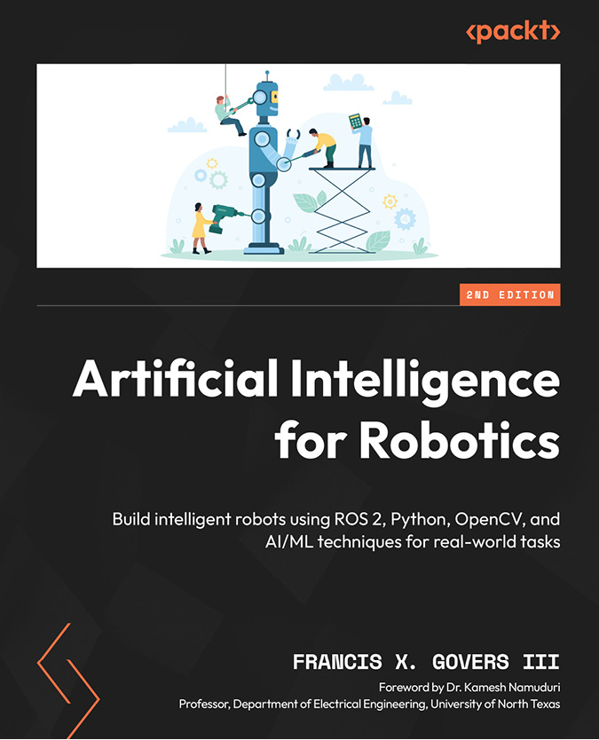
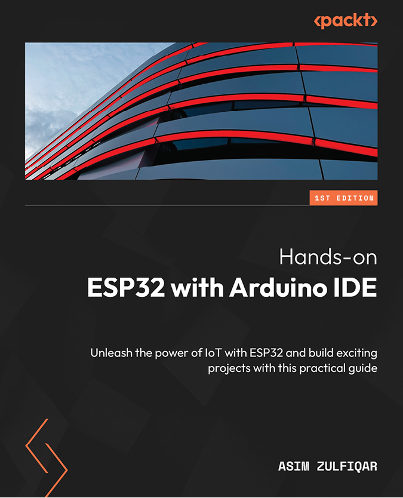

[packtpub.com](http://packtpub.com)

Subscribe to our online digital library for full access to over 7,000 books and videos, as well as industry leading tools to help you plan your personal development and advance your career. For more information, please visit our website.

# Why subscribe?

- Spend less time learning and more time coding with practical eBooks and Videos from over 4,000 industry professionals
- Improve your learning with Skill Plans built especially for you
- Get a free eBook or video every month
- Fully searchable for easy access to vital information
- Copy and paste, print, and bookmark content

Did you know that Packt offers eBook versions of every book published, with PDF and ePub files available? You can upgrade to the eBook version at [packtpub.com](http://packtpub.com) and as a print book customer, you are entitled to a discount on the eBook copy. Get in touch with us at [customercare@packtpub.com](mailto:customercare@packtpub.com) for more details.

At [www.packtpub.com](http://www.packtpub.com), you can also read a collection of free technical articles, sign up for a range of free newsletters, and receive exclusive discounts and offers on Packt books and eBooks.

# Other Books You May Enjoy

If you enjoyed this book, you may be interested in these other books by Packt:

**Artificial Intelligence** **for Robotics**

Francis X. Govers III

ISBN: 9781805129592

- Get started with robotics and AI essentials
- Understand path planning, decision trees, and search algorithms to enhance your robot
- Explore object recognition using neural networks and supervised learning techniques
- Employ genetic algorithms to enable your robot arm to manipulate objects
- Teach your robot to listen using Natural Language Processing through an expert system
- Program your robot in how to avoid obstacles and retrieve objects with machine learning and computer vision
- Apply simulation techniques to give your robot an artificial personality

**Hands-on ESP32 with** **Arduino IDE**

Asim Zulfiqar

ISBN: 9781837638031

- Understand the architecture of ESP32 including all its ins and outs
- Get to grips with writing code for ESP32 using Arduino IDE 2.0
- Interface sensors with ESP32, focusing on the science behind it
- Familiarize yourself with the architecture of various IoT network protocols in-depth
- Gain an understanding of the network protocols involved in IoT device communication
- Evaluate and select the ideal data-based IoT protocol for your project or application
- Apply IoT principles to real-world projects using Arduino IDE 2.0

# Packt is searching for authors like you

If you’re interested in becoming an author for Packt, please visit [authors.packtpub.com](http://authors.packtpub.com) and apply today. We have worked with thousands of developers and tech professionals, just like you, to help them share their insight with the global tech community. You can make a general application, apply for a specific hot topic that we are recruiting an author for, or submit your own idea.

# Share Your Thoughts

Now you’ve finished *ROS 2 from Scratch*, we’d love to hear your thoughts! If you purchased the book from Amazon, please [click here to go straight to the Amazon review page](https://packt.link/r/1835881416) for this book and share your feedback or leave a review on the site that you purchased it from.

Your review is important to us and the tech community and will help us make sure we’re delivering excellent quality content.
